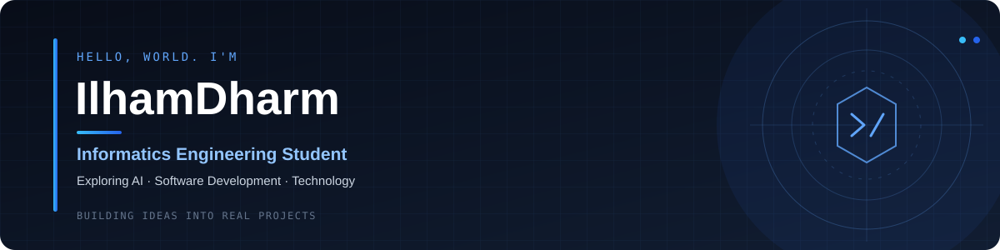

<p align="center">
  
</p>

<div align="center">

---

## 👨‍💻 About Me

```text
🎓 Informatics Engineering Student
🏫 Politeknik Negeri Malang
🤖 Aspiring AI Engineer
💻 Interested in Backend & Full-Stack Development
🐍 Currently learning Python & AI Development
🚀 Building projects to turn ideas into useful applications
```
## 💻 Tech Stack

### Languages

<p>
  
</p>

### Frameworks & Development

<p>
  
</p>

### Database & Tools

<p>  <br>  </p>

---
<!-- PROJECT SHOWCASE -->
<h2 align="center">🚀 Featured Projects</h2>

<p align="center">
  <em>Selected projects, experiments, and ideas in progress.</em>
</p>

<table>
  <tr>
    <td width="50%" valign="top">
      <h3>🤖 RepoInsight AI</h3>
      <p>
        Exploring AI-powered repository insights and
        tools for developer workflows.
      </p>
      <p>
        <strong>Focus:</strong> Artificial Intelligence<br/>
        <strong>Category:</strong> Developer Tools
      </p>
      <a href="https://github.com/IlhamDharm/repoinsight-ai">
        ↗ Explore Repository
      </a>
    </td>
    <td width="50%" valign="top">
      <h3>🏔️ SafeHike</h3>
      <p>
        An outdoor project exploring ways to support
        safer and more informed hiking activities.
      </p>
      <p>
        <strong>Focus:</strong> Outdoor Safety<br/>
        <strong>Category:</strong> Application
      </p>
      <a href="https://github.com/IlhamDharm/SafeHike">
        ↗ Explore Repository
      </a>
    </td>
  </tr>
  <tr>
    <td colspan="2" valign="top">
      <h3>⛺ CampSpot — Outdoor Equipment Rental</h3>
      <p>
        A technopreneurship project focused on an outdoor
        equipment rental concept for hiking enthusiasts.
      </p>
      <p>
        <strong>Focus:</strong> Rental Marketplace<br/>
        <strong>Category:</strong> Technopreneurship
      </p>
      <a href="https://github.com/IlhamDharm/Sewa-Alat-Outdoor">
        ↗ Explore Repository
      </a>
    </td>
  </tr>
</table>

<p align="center">
  <a href="https://github.com/IlhamDharm?tab=repositories">
    <strong>View All Repositories →</strong>
  </a>
</p>

## 📊 GitHub Statistics
<p align="center">
  
</p>

---


---

## 📫 Connect With Me

<p align="center">
  <a href="https://github.com/IlhamDharm">
    
  </a>
  <a href="https://www.instagram.com/ilhmdharm/">
    
  </a>
  <a href="mailto:meniandol@gmail.com">
    
  </a>
</p>

<p align="center">
  <em>Always Learning & Building 🚀</em>
</p>

<p align="center">
  
</p>

